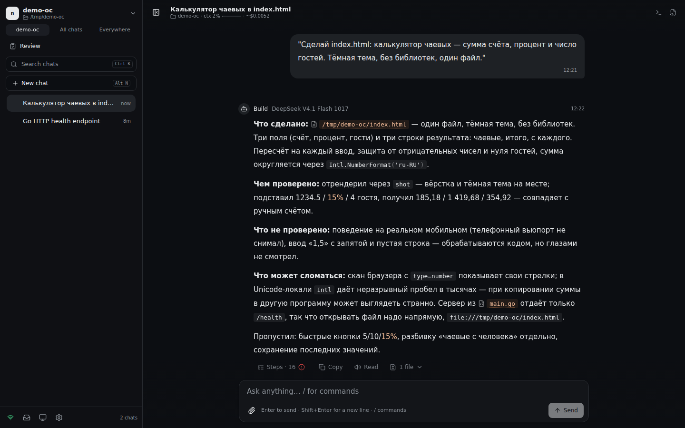

# Bogdan Sergeevichev

Backend и инструменты для разработчиков: Go, TypeScript, Kotlin.
Четвёртый курс Computer Engineering, Университет Антальи. Ищу удалённую работу.

## Проекты

- [nit-web](https://github.com/bongdo/nit-web) — веб-интерфейс к AI-агенту:
  чаты, стриминг, HTML прямо в сообщении, несколько серверов в одном окне.
- [nit-android](https://github.com/bongdo/nit-android) — тот же агент на Android:
  Kotlin, Compose, офлайн-кэш.
- [nit-terminal](https://github.com/bongdo/nit-terminal) и
  [nit-terminal-core](https://github.com/bongdo/nit-terminal-core) — терминал в
  браузере: один бинарник, tmux-сессии, вкладки.
- [pero-editor](https://github.com/bongdo/pero-editor) — терминальный редактор кода:
  вкладки, LSP, мышь, поиск и замена, AI-подсказки.
- [ink-lang](https://github.com/bongdo/ink-lang) — свой язык программирования:
  компилятор, LSP, форматтер, рантайм на Go.

## Стек

Go, TypeScript, React, SQL, Kotlin; PostgreSQL, SQLite; Linux, NixOS, systemd,
nginx, Caddy, Docker, Tailscale.

## Связь

[bongdoq@gmail.com](mailto:bongdoq@gmail.com) · [t.me/bongdo](https://t.me/bongdo)
